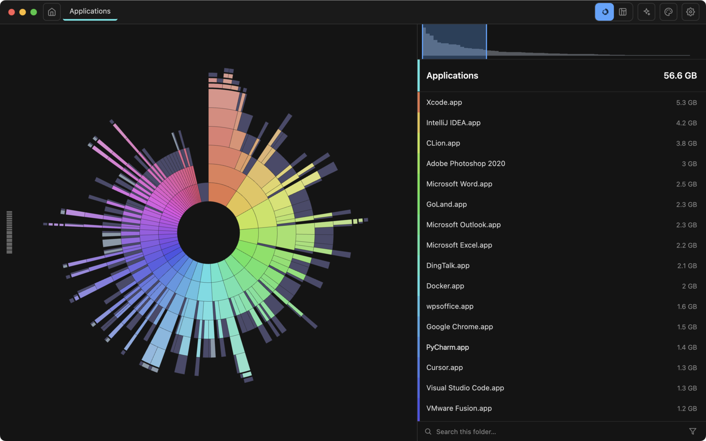

# ZingDisk

**See your disk. Clearly.**

A blazing-fast disk space analyzer for macOS and Windows — scan a whole disk in seconds, then see every layer of it.

[Website](https://zingdisk.app) · [Support](https://zingdisk.app/support.html) · [Release notes](https://github.com/whatbugsyou/ZingDisk-releases/releases) · [中文说明](#中文)

---

## Download

| Platform | Requirements | Get it |
| --- | --- | --- |
| **macOS** | macOS 13 Ventura or later · Apple silicon and Intel | [Mac App Store](https://apps.apple.com/us/search?term=ZingDisk&platform=mac) |
| **Windows** | Windows 10 or later · 64-bit | [Latest release](https://github.com/whatbugsyou/ZingDisk-releases/releases/latest) |

Free to use. Windows builds are published in this repository; the macOS build ships through the Mac App Store.

## What it does

- **Scan at the speed of thought.** Three speed modes — Blazing, Fast and Normal — let you decide how much of your machine the scan may use.
- **Sunburst view.** Your whole disk as one interactive chart: every ring is a layer of folders, every wedge a folder or file.
- **Layer view.** The same data as pages of rectangles — ancestor folders line up like books on a shelf, and the level scale jumps you straight to any depth.
- **Search, filter and preview.** Find files as you type, filter by type or tag, hover for a thumbnail, press Space for a full preview.
- **AI analysis.** Right-click a directory and get a streaming explanation of what it is and what is safe to remove.
- **Themes.** Ten chart palettes for the sunburst and rectangle views, plus two dark interface themes.
- **Safe by design.** Deleting moves items to the Trash or Recycle Bin — nothing disappears behind your back.

## Screenshots

| Layer view | Scan speed |
| --- | --- |
|  |  |

| AI analysis | Hover preview |
| --- | --- |
|  |  |

## What's new

### 1.6.0

- **Windows support** — the first release that runs on Windows: long paths scan completely, delete to the Recycle Bin, Explorer-style previews, and a title bar that keeps Windows 11 snap layouts.
- **A refreshed interface** — new default colour scheme, plus two dark themes (One Dark Pro and macOS Classic Dark) in the new Appearance section in Settings.
- **The breadcrumb follows the layer ruler** while you drag, and returns you to the focal folder with one click.
- **Cleaner sunburst separators** and lighter animation.

[Full release notes →](https://github.com/whatbugsyou/ZingDisk-releases/releases/tag/v1.6.0)

---

## 中文

**看清磁盘，一目了然。**

macOS 与 Windows 的磁盘空间分析工具——几秒钟扫完整个磁盘，然后逐层看清它的全貌。

| 平台 | 系统要求 | 下载 |
| --- | --- | --- |
| **macOS** | macOS 13 Ventura 或更高 · Apple 芯片与 Intel | [Mac App Store](https://apps.apple.com/us/search?term=ZingDisk&platform=mac) |
| **Windows** | Windows 10 或更高 · 64 位 | [最新版本](https://github.com/whatbugsyou/ZingDisk-releases/releases/latest) |

免费使用。Windows 版在本仓库发布；macOS 版经 Mac App Store 分发。

**主要功能**

- **极速扫描**：Blazing / Fast / Normal 三档速度，自己决定扫描能用多少机器性能。
- **旭日图**：整个磁盘一张可交互的图，每一环是一层目录，每一片是一个目录或文件。
- **层级图**：同一份数据的矩形分层视图，祖先目录像书架一样排开，层刻度直接跳到任意深度。
- **搜索、筛选与预览**：键入即找，按类型或标签筛选，悬停看缩略图，空格键全屏预览。
- **AI 分析**：右键目录，流式读出它是什么、什么可以安全删除。
- **主题**：旭日图与矩形图共十套配色，另有深色界面主题。
- **删得放心**：删除是把文件移进废纸篓 / 回收站，随时可以还原。

**1.6.0 新内容**：首个 Windows 版本（超长路径、回收站、资源管理器式预览）、全新的默认配色与两套深色主题、面包屑跟随层刻度拖动、旭日分隔缝更干净。[完整发布说明 →](https://github.com/whatbugsyou/ZingDisk-releases/releases/tag/v1.6.0)

---

© 2026 ZingDisk · <a href="https://zingdisk.app">zingdisk.app</a> · <a href="https://zingdisk.app/privacy.html">Privacy</a> · <a href="https://zingdisk.app/terms.html">Terms</a>

