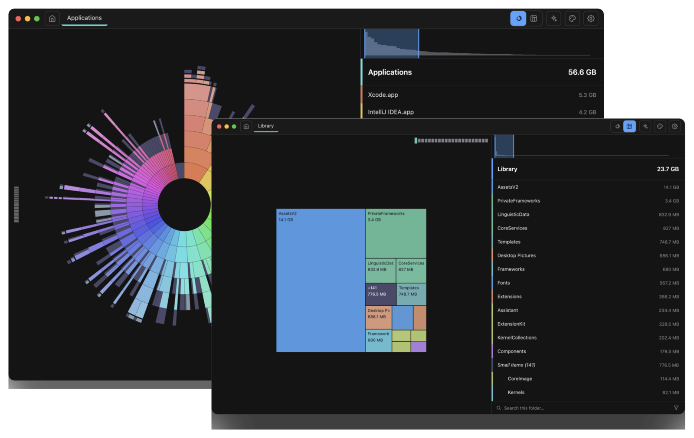
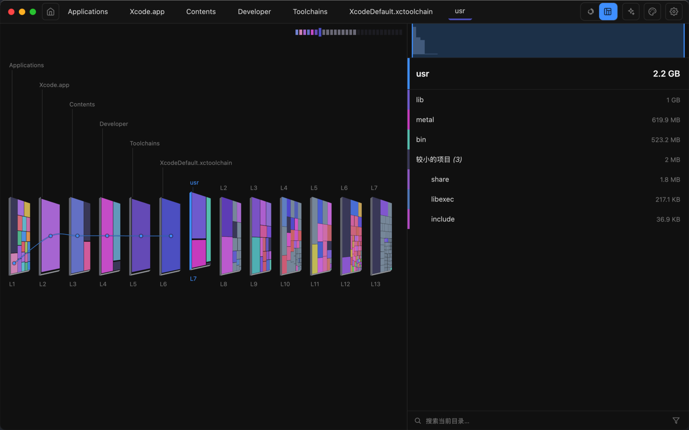
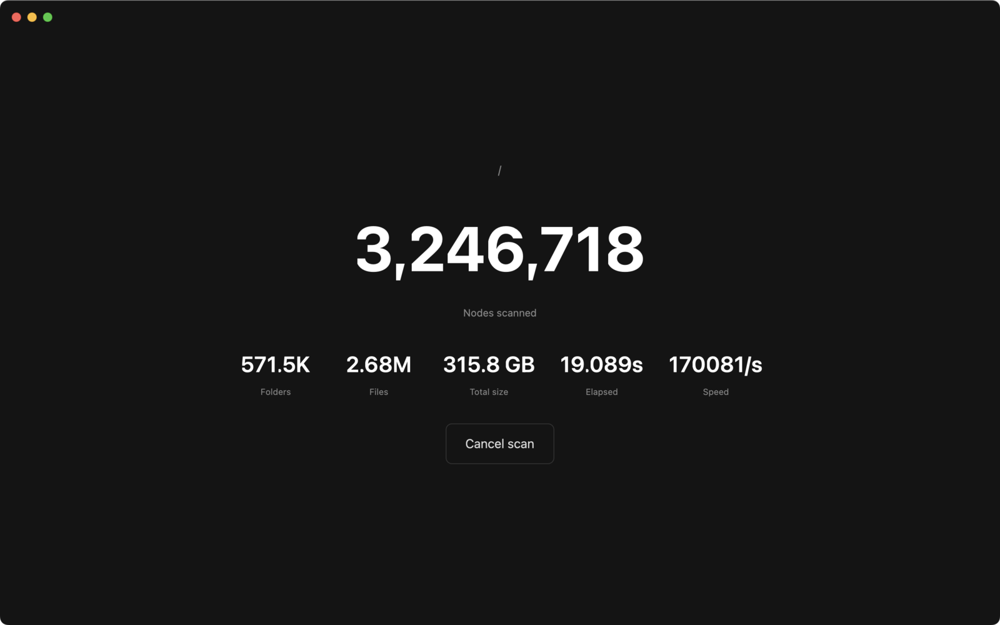
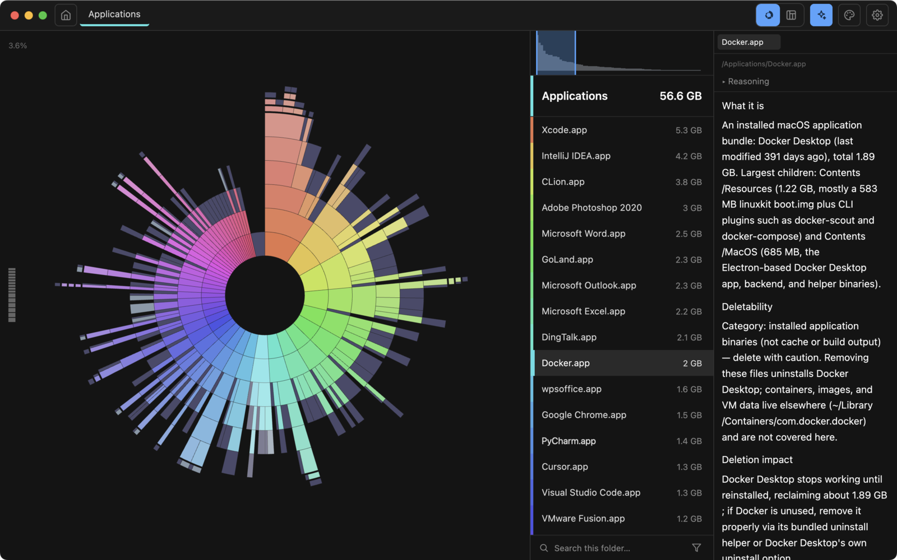
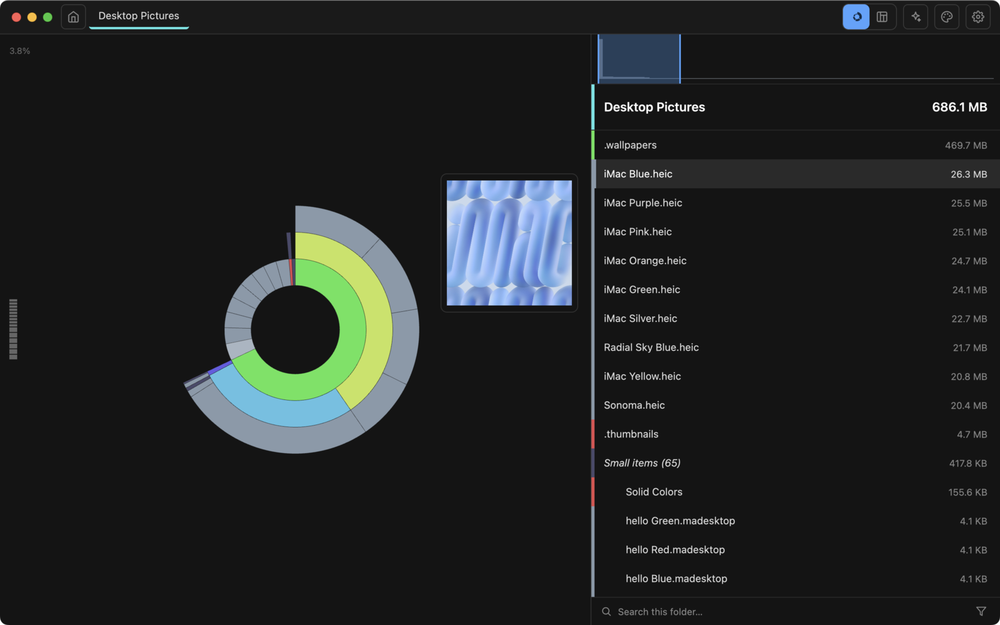

# ZingDisk

**洞察磁盘。一目了然。**

ZingDisk 是一款为 macOS 与 Windows 打造的极速磁盘空间分析工具。旭日图与矩形层级图双视图，精准可视化存储去向，自信回收磁盘空间。

[官网](https://zingdisk.app) · [支持](https://zingdisk.app/support.html) · [发布说明](https://github.com/whatbugsyou/ZingDisk-releases/releases) · [English](README.md) · **简体中文**

---

## 下载

| 平台 | 系统要求 | 下载 |
| --- | --- | --- |
| **macOS** | macOS 13 Ventura 或更高 · Apple 芯片与 Intel | [Mac App Store](https://apps.apple.com/us/search?term=ZingDisk&platform=mac) |
| **Windows** | Windows 10 1903+ / Windows 11 22H2+ · 64 位 · DirectX 11 GPU | [最新版本](https://github.com/whatbugsyou/ZingDisk-releases/releases/latest) |

免费使用。Windows 版在本仓库发布；macOS 版经 Mac App Store 分发。Windows 版需要支持 DirectX 11 的 GPU 与最新显卡驱动。

## 主要功能

- **极速扫描**：Blazing / Fast / Normal 三档速度模式，自己决定扫描能用多少机器性能。
- **旭日图**：整个磁盘一张可交互的图——每一环是一层目录，每一片是一个目录或文件。
- **层级图**：同一份数据的矩形分层视图，祖先目录如书架般陈列，拖动层刻度直接跳到任意深度。
- **搜索、筛选与预览**：输入即定位，按类型或颜色标记筛选，悬停看缩略图，空格键全屏预览。
- **AI 智能分析**：右键任意目录，流式解读它是什么、什么可以安全清理。
- **主题**：旭日图与矩形图共十套配色，另有两套深色界面主题。
- **删得放心**：删除是把文件移进废纸篓 / 回收站，随时可以还原。

## 截图

| 层级图 | 扫描速度 |
| --- | --- |
|  |  |

| AI 智能分析 | 悬停预览 |
| --- | --- |
|  |  |

## 新版本

### 1.6.0

- **Windows 支持**——首个可在 Windows 上运行的版本：超长路径照样扫全、移到回收站、资源管理器式预览，标题栏保留 Windows 11 贴靠布局弹层。
- **界面焕新**——新的默认配色，外加两套深色主题（One Dark Pro 与 macOS Classic Dark），设置页新增「外观」分区。
- **面包屑跟随层刻度**——拖动时实时跟随，点击高亮项一键回到当前目录。
- **旭日分隔缝更干净**，动画更轻。

[完整发布说明 →](https://github.com/whatbugsyou/ZingDisk-releases/releases/tag/v1.6.0)

---

© 2026 ZingDisk · <a href="https://zingdisk.app">zingdisk.app</a> · <a href="https://zingdisk.app/privacy.html">隐私政策</a> · <a href="https://zingdisk.app/terms.html">使用条款</a>

